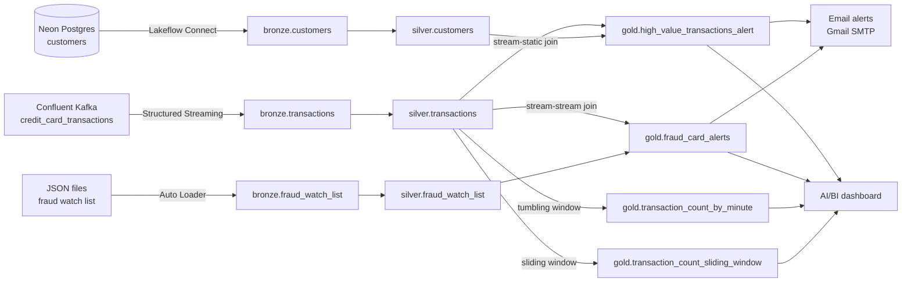

# FinGuard: Real-Time Credit Card Fraud Detection


An end-to-end **streaming data pipeline** for a fictional bank. Card transactions arrive from **Kafka**, blocked-card files arrive as **JSON drops**, and customer master data comes from **Postgres**. Everything lands in **Delta tables** on Databricks following the bronze, silver and gold layers. Two fraud rules run in near real time, every hit sends an **email alert**, and a **dashboard** refreshes every minute.

## Contents

- [The problem](#the-problem)
- [Architecture](#architecture)
- [Fraud rules](#fraud-rules)
- [Data model](#data-model)
- [Tech stack](#tech-stack)
- [Repository structure](#repository-structure)
- [Quick start](#quick-start)
- [Security](#security)
- [Limitations and next steps](#limitations-and-next-steps)
- [Docs](#docs)
- [Acknowledgements](#acknowledgements)

## The problem

FinGuard processes a large volume of card transactions from ATMs, point-of-sale terminals and online gateways, and also receives fraud intelligence (blocked or flagged cards). Batch jobs that run hourly or daily find fraud too late. The goal is to detect suspicious activity **within seconds** and alert the customer immediately.

| Challenge | How this project handles it |
| --- | --- |
| Fraud found hours late | Kafka plus Spark Structured Streaming, run continuously |
| Signals spread across systems | Three sources: Kafka stream, file stream (Auto Loader), Postgres batch (Lakeflow Connect) |
| Joining a moving stream with static data | Stream-static left join against `silver.customers` |
| Joining two moving streams safely | Stream-stream inner join with watermarks on both sides |
| Counting on never-ending data | Tumbling and sliding windows with a watermark |
| Late-arriving events | Watermark threshold bounds state and drops very late data |
| Credentials in code | Databricks secret scope; no keys in notebooks or Git |
| Hand-built checkpoints and retries | Lakeflow Spark Declarative Pipelines manage them |
| Bad data reaching silver | `expect` and `expect_or_drop` data quality rules |
| Postgres loads without custom code | Lakeflow Connect incremental ingestion (cursor column) |

## Architecture



Governance is handled by **Unity Catalog** (catalog `finguard`, schemas `source`, `bronze`, `silver`, `gold`). Credentials live in the secret scope `finguard-scope`.

## Fraud rules

1. **High-value transaction** (stream-static join): the transaction amount is greater than the customer's `transaction_limit`.
2. **Fraud watch list match** (stream-stream join): a transaction is made on a card that appears on the watch list, within a 5-minute watermark window.

Bonus analytics: transactions per minute (**tumbling window**) and per 5 minutes sliding every minute (**sliding window**).

## Data model

| Layer | Table | Built by | Contents |
| --- | --- | --- | --- |
| bronze | `bronze.transactions` | SDP streaming table from Kafka | Raw key, value, topic, partition, offset, timestamp, `injection_timestamp` |
| bronze | `bronze.customers` | Lakeflow Connect | Incremental copy of Postgres `customers` |
| bronze | `bronze.fraud_watch_list` | SDP + Auto Loader | Raw watch list rows, `_rescued_data`, `source_file` |
| silver | `silver.transactions` | SDP | JSON parsed into columns, Kafka metadata, five data quality rules |
| silver | `silver.customers` | Separate SDP pipeline | `account_open_date` typed as date |
| silver | `silver.fraud_watch_list` | SDP | Upper-cased IDs and action, `effective_from` as timestamp |
| gold | `gold.high_value_transactions_alert` | SDP, stream-static join | Alerts where amount exceeds the customer limit |
| gold | `gold.fraud_card_alerts` | SDP, stream-stream join | Transactions on watch-listed cards |
| gold | `gold.transaction_count_by_minute` | SDP, tumbling window | Count per 1-minute window |
| gold | `gold.transaction_count_sliding_window` | SDP, sliding window | Count per 5-minute window, slide 1 minute |

Orchestration: the streaming pipeline runs in **Continuous** mode, the dashboard refreshes every minute, and a **Lakeflow Job** loads customers daily (ingestion pipeline, then silver pipeline).

## Tech stack

- **Databricks Free Edition**: serverless compute, notebooks, Unity Catalog, Lakeflow Jobs, AI/BI dashboards
- **Apache Spark Structured Streaming** and **Delta Lake**
- **Lakeflow Spark Declarative Pipelines** (`pyspark.pipelines`), **Auto Loader** (`cloudFiles`), **Lakeflow Connect**
- **Confluent Cloud (Kafka)** with the SASL_SSL / PLAIN connection pattern
- **Neon PostgreSQL** as the static customer source
- **Python** (`pandas`, `smtplib`, `databricks-sdk`) for data generation and email alerts

## Repository structure

```
finguard-realtime-fraud-detection/
├── README.md
├── docs/
│   ├── SETUP.md                  # step-by-step build guide and troubleshooting
│   └── CONCEPTS.md               # Kafka, watermarks, windows, joins explained
├── notebooks/                    # Databricks notebooks (source format)
│   ├── 00_setup_catalog_and_volumes.py
│   ├── 01_set_up_secrets.py
│   ├── 02_kafka_streaming_test.py
│   ├── 03_email_test.py
│   ├── 05_fraud_watchlist_data_generator.py
│   └── 06_autoloader_test.py
└── pipelines/
    ├── streaming/                # finguard-streaming pipeline
    │   ├── bronze/               # transactions, fraud watch list
    │   ├── silver/               # transactions, fraud watch list
    │   ├── gold/                 # alerts and window aggregations
    │   └── alert/                # email notifier sinks
    └── customers_silver/         # daily customers silver pipeline
```

## Quick start

1. Create free accounts: Databricks Free Edition, Confluent Cloud, Neon, and a Gmail App Password.
2. Create the Kafka topic `credit_card_transactions` and run the producer to publish transactions.
3. Import `notebooks/` into Databricks and run `00_setup_catalog_and_volumes.py`, then `01_set_up_secrets.py` with your own values.
4. Create the `finguard-streaming` pipeline from `pipelines/streaming/` and the customers pipeline from `pipelines/customers_silver/`.
5. Trigger a high-value transaction and generate watch list files, then check the gold tables and your inbox.

The full walkthrough with checks at every step is in [docs/SETUP.md](docs/SETUP.md).

## Security

- No credentials are stored in this repository. Kafka and Gmail secrets live in the Databricks secret scope `finguard-scope`.
- The notebooks contain `<PLACEHOLDER>` values. Fill them in only inside Databricks and clear the cell after running it.
- `.env` files and `.dbc` archives are git-ignored because notebook exports can contain outputs and credentials.
- Revoke the Confluent API key and Gmail App Password, and delete the Confluent cluster, when you finish experimenting.

## Limitations and next steps

- Fraud rules are intentionally simple (amount limit and watch list). Next: velocity checks (many transactions per card in 10 minutes with a sliding window), geo-anomaly rules, or an ML score.
- The email sink uses `collect()` and sends one email per row through a personal Gmail account. It does not scale and has no retry or de-duplication. A production design would publish alerts to a queue or a transactional email service and keep an alert-history table.
- Watermarks are 5 minutes for demo purposes; real systems use hours or days because a card can be flagged long after a purchase.
- Databricks Free Edition limits: serverless only, no `processingTime` trigger, and compute can be busy.
- No automated tests yet. Next: unit tests for the transformation logic and a dead-letter table for malformed records.

## Docs

- [Setup guide](docs/SETUP.md): build everything from scratch, with troubleshooting.
- [Concepts cheat sheet](docs/CONCEPTS.md): streaming, Kafka, watermarks, windows and joins.
- [Pipelines](pipelines/README.md): what to verify against your own data.

## Acknowledgements

Built while following the end-to-end streaming data project tutorial by **Narendra Kumar** (Databricks Free Edition with Confluent Kafka). The Kafka producer scripts, Postgres seed SQL and the watch list CSV come from the author's public repository and are not redistributed here.
